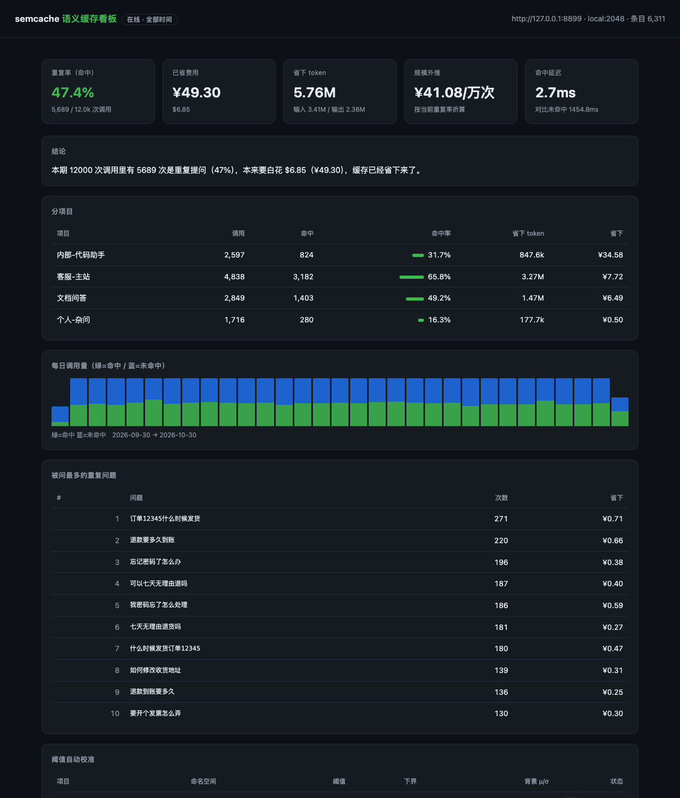

# semcache

面向 OpenAI 兼容 `chat/completions` 接口的语义缓存代理。

它部署在客户端和模型服务之间，把语义上重复的提问直接用本地缓存回答，同时记录每次命中
省下的 token 和费用。适合客服机器人、内部知识库问答、模板化生成这类提问重复度高的场景。

- 单文件，只用标准库（装了 numpy 会自动用来加速）
- SQLite 存向量和账本，按项目隔离
- 命中阈值按语料自动校准，支持线上反馈修正
- 输出重复率和费用报告，附实时看板
- 支持流式响应缓存，命中时回放成 SSE
- 支持影子模式：只统计能省多少，不真正命中

## 运行

需要 Python 3.9 及以上，没有第三方依赖。

```bash
git clone <repo-url> semcache && cd semcache
python semcache.py serve
```

不带子命令时默认就是 `serve`，所以 `python semcache.py --port 9000` 也能直接起。

默认监听 `127.0.0.1:8787`，上游是 `https://api.openai.com`。

也可以只拿走 `semcache.py` 一个文件，放到任何有 Python 的机器上运行，不装包、不起容器。
想用命令行入口的话：

```bash
pipx install .        # 之后直接用 semcache serve
```

## 客户端接入

把 `base_url` 指到代理即可，其余代码不用动。

```python
from openai import OpenAI

client = OpenAI(
    base_url="http://127.0.0.1:8787/v1",
    api_key="sk-...",          # 原样透传给上游；也可以用 --upstream-key 由代理注入
)

resp = client.chat.completions.create(
    model="gpt-4o-mini",
    messages=[{"role": "user", "content": "退款要多久到账？"}],
)
```

```bash
curl http://127.0.0.1:8787/v1/chat/completions \
  -H "Content-Type: application/json" \
  -H "Authorization: Bearer $OPENAI_API_KEY" \
  -d '{"model":"gpt-4o-mini","messages":[{"role":"user","content":"退款要多久到账？"}]}'
```

命中时响应头会带上判定结果：

```
X-Semcache: hit
X-Semcache-Kind: semantic
X-Semcache-Score: 0.9341
X-Semcache-Threshold: 0.9120
X-Semcache-Tokens-Saved: 2381
X-Semcache-Cost-Saved-USD: 0.002143
```

## 报告

`report` 汇总 `events` 表，给出重复率、节省的 token 与费用、分项目明细、高频重复问题和
当前阈值。下面是一份 12000 次调用的示例输出（完整版见
[docs/report-sample.txt](docs/report-sample.txt)，Markdown 版见
[docs/report-sample.md](docs/report-sample.md)）：

```
 调用总数             12.0k 次
 命中缓存        5689 次（精确 4881 / 语义 808）
 重复率               47.4%
 省下 token         5.76M（输入 3.41M / 输出 2.36M）
 省下费用           $6.85 = ¥49.30
 平均延迟      命中 2.7ms ／ 未命中 1454.8ms
 结论：本期 12000 次调用中，5689 次是重复提问（47%），已由缓存直接返回，
       省下 $6.85（¥49.30）。
 规模外推      按当前重复率，每 1 万次调用约省 ¥41.08（$5.71）
 安全拦截      6307 次：提问相似，但单号/金额/ID 不同，未命中
 阈值自动校准  4 个命名空间 ／ 阈值 0.470~0.493 ／ 安全下界 0.450~0.473
```

```bash
python semcache.py report                          # 终端表格
python semcache.py report --md --out 月报.md        # Markdown
python semcache.py report --json                   # 接 BI
python semcache.py report --month 2026-10 --project 客服-主站
```

浏览器看板在 `http://127.0.0.1:8787/dashboard`，每 5 秒刷新一次：



上线前建议先跑影子模式，只记账不命中，用真实流量估一下收益：

```bash
python semcache.py serve --dry-run
```

## 工作方式

### 一次请求的处理顺序

1. 读请求体，解析 `messages`。
2. 判断能不能缓存：`n > 1`、`logprobs`、多模态内容、温度超过 `--max-temperature`，任一条命中就
   直接透传，只记一条 `bypass`。
3. 算命名空间 `ns = sha256(embedder, model, system prompt, tools, response_format)`。
   这几样任何一个变了，就是另一个缓存空间。
4. 精确命中：用归一化后的提问算 `qhash`，在 `(project, ns)` 下做主键查询，不走向量。
5. 语义命中：取提问的向量，在当前命名空间的向量矩阵里做点积，取最相似的一条，再依次过
   「实体一致」「相似度阈值」「词面门槛」三道检查。
6. 没命中就转发给上游，把完整响应写进缓存；流式响应会一边转发一边把 SSE 拼回完整答案。

### 命中判定

只看相似度不够，实际判定有四步：

- **实体一致**：从提问里抽出数字、单号、金额、邮箱、URL、长 ID，两边的集合必须完全相同。
  `订单 12345` 和 `订单 67890` 的向量相似度能到 0.95 以上，但答案不一样。
- **相似度**：余弦相似度不低于当前命名空间的阈值（见下节）。
- **词面门槛**（仅 `local` 向量）：词集合的 Jaccard 不低于 `--lexical-gate`，重叠系数不低于
  `--lexical-cover`。本地向量本质是词面 n-gram 哈希，加这道门是为了挡住哈希碰撞。
- **`max_tokens`**：缓存答案比本次请求允许的长度还长时，按未命中处理。

### 阈值校准

阈值不写死。不同语料、不同 embedding 模型，相似度的量纲差别很大：客服语料里两个不相关的
问题可能就有 0.72，代码语料里可能只有 0.15。

```
floor = clip(μ + 3σ, 先验下界, 先验下界 + 0.15)
eff   = clip(floor + 边际 + 反馈偏置, 0, 0.995)
```

- `μ`、`σ` 取自当前命名空间的向量两两余弦，但先掐掉最相似的 10%。这部分多半是真重复而不是
  背景噪声，留着会把阈值抬得没有意义。用剩下的 90% 估计「两个无关问题能有多像」。
- 先验下界按 embedder 给护栏：`openai` 0.80，`local` 0.45。语料越同质，`floor` 越高，
  但最多比先验高 0.15，避免同质语料把缓存关死。
- 反馈偏置来自两个信号：
  - 显式差评，`POST /admin/feedback`，直接把阈值抬到「那次误命中的分数 + 0.02」之上；
  - 隐式差评，语义命中后 240 秒内用户又问了同一个问题，小幅上调。只对语义命中生效，
    精确命中的重问更可能是网络重试，不计入。

  偏置每轮校准衰减 15%，误判会自己淡出。

每次调整写进 `calib_log` 表，`python semcache.py calibrate --all` 可以手动重算。

### 项目隔离

隔离分三层：

| 层 | 做法 |
|---|---|
| 向量 | 只在 `(project, ns)` 分区里检索，跨项目在物理上不会命中 |
| 命名空间 | 由 model、system prompt、tools、response_format 决定，换系统提示词等于换缓存空间 |
| 阈值 | 每个 `(project, ns)` 一套独立参数 |

项目名来源，优先级从高到低：

```bash
# 按 API key 前缀自动分（多租户）
python semcache.py serve --project-keys "客服=sk-live-a,内部=sk-live-b"
```

其次看请求头 `X-Semcache-Project`，最后兜底用 `Authorization` 里 key 的哈希前缀。
客户端想显式指定时加一行 header 就行：

```bash
-H "X-Semcache-Project: 客服-主站"
```

## 缓存范围

| 情况 | 行为 | 说明 |
|---|---|---|
| `temperature` ≤ `--max-temperature`（默认 1.0） | 缓存 | 要只缓存确定性答案，设成 0.2 |
| `stream: true` | 缓存 | 命中时回放成 `chat.completion.chunk` + `[DONE]` |
| 带 `tools` / `functions` | 缓存 | schema 进命名空间；返回值带 `tool_calls` 的不缓存 |
| 图片、音频 | 不缓存 | 多模态相似度没做 |
| `n > 1`、`logprobs` | 不缓存 | |
| `finish_reason == "length"` | 不缓存 | 截断的答案不应缓存 |
| 上游 4xx / 5xx | 不缓存 | 只记一条 `error` |
| 其他接口（`/v1/embeddings`、`/v1/models` 等） | 透传 | 只记账，不缓存 |

客户端还可以用 `X-Semcache-No-Cache: 1` 单次绕过。

## 配置

命令行参数、`SEMCACHE_*` 环境变量、`--config xxx.json` 三种来源，优先级：命令行 >
环境变量 > 配置文件 > 默认值。

| 参数 | 默认 | 说明 |
|---|---|---|
| `--host` / `--port` | 127.0.0.1 / 8787 | 监听地址 |
| `--upstream` | `https://api.openai.com` | 上游 base_url，任何 OpenAI 兼容服务 |
| `--upstream-key` | 空 | 为空时透传客户端的 `Authorization` |
| `--embedder` | `local` | `local` 或 `openai` |
| `--embed-model` | `text-embedding-3-small` | openai 模式用的向量模型 |
| `--dim` | 2048 | local 向量维度；openai 模式作为 `dimensions` 参数 |
| `--threshold` | 0（自动） | 设了就用固定阈值，关闭自动校准 |
| `--min-threshold` | 0（按 embedder） | 阈值安全下界 |
| `--max-floor-lift` | 0.15 | 阈值相对先验最多抬高多少 |
| `--ttl` | 30 天 | 条目过期时间，0 表示不过期 |
| `--max-entries` | 200000 | 每项目条目上限，超出按 LRU 淘汰 |
| `--max-temperature` | 1.0 | 高于此温度不缓存 |
| `--dry-run` | 关 | 影子模式 |
| `--admin-token` | 空 | 管理接口和看板的口令 |
| `--project-keys` | 空 | `客服=sk-a,内部=sk-b` |
| `--price` | 内置价目表 | `--price "my-model=0.5/1.5"`，单位 $/1M tokens，可重复 |
| `--usd-cny` | 7.2 | 报告里的汇率 |
| `--calib-every` | 200 | 每 N 次查询触发一次校准 |
| `--repeat-window` | 240 | 命中后多少秒内重问算隐式差评 |
| `--no-implicit-feedback` | — | 关闭隐式差评 |
| `--lexical-gate` / `--lexical-cover` | 0.6 / 0.8 | local 模式的词面门槛 |
| `--no-cache-stream` | — | 不缓存流式响应 |

### 两种 embedder

| | `local` | `openai` |
|---|---|---|
| 成本 | 0 | 约 $0.02 / 1M tokens |
| 网络 | 不需要 | 需要能调 embedding 接口 |
| 能命中 | 标点、空格、大小写、语序、少量增删 | 真正的改写，如「退款要多久到账」和「退款多久能到账」 |
| 适合 | 固定话术、FAQ 按钮、内部工具 | 客服对话、RAG 问答等真实用户输入 |

`local` 是词面 n-gram 哈希，只能处理近似重复，跨语义改写需要 `--embedder openai`。
中文改写场景建议直接上 openai。报告里语义命中占比过低时会提示这一点。

## 命令

```bash
python semcache.py serve                  # 起代理，等价于不带子命令直接运行
python semcache.py serve --dry-run        # 影子模式
python semcache.py report [--month YYYY-MM] [--project P] [--md|--json] [--out FILE]
python semcache.py calibrate --all        # 立刻重算所有阈值
python semcache.py stats                  # 一行摘要
python semcache.py selftest               # 24 项自检
python semcache.py demo                   # 造 12000 次调用，打印一份账单
```

## HTTP 接口

| 接口 | 说明 |
|---|---|
| `POST /v1/chat/completions` | 缓存入口；其他路径原样透传 |
| `GET /healthz` | 健康检查 |
| `GET /dashboard` | 看板 |
| `GET /admin/stats` | 看板数据源 |
| `GET /admin/report` | 报告，`format` 取 `text` / `md` / `json` |
| `GET /admin/calib` | 当前所有阈值 |
| `POST /admin/calibrate` | 立刻重算 |
| `POST /admin/feedback` | `{"project","ns","label":"bad","score":0.93}` |
| `POST /admin/clear` | 清缓存，可带 `project` / `ns` |

设置了 `--admin-token` 时，管理接口需要 `?token=xxx` 或 `Authorization: Bearer xxx`。

## 数据表

```sql
entries(id, project, ns, qhash, prompt, answer, vec, dim, model,
        created_at, last_hit_at, hits, prompt_tokens, completion_tokens,
        finish_reason, expires_at, ents, meta)

events (id, ts, day, project, ns, model, kind, detail, score,
        prompt_tokens, completion_tokens, cost_saved, cost_extra,
        latency_ms, prompt, entry_id)      -- 账本，报告的数据来源

calib       (project, ns, base, bias, eff, floor, mu, sigma, p99,
             lookups, hits, bad, status, updated_at)
calib_log   (ts, project, ns, old_eff, new_eff, floor, mu, sigma, reason)
embed_cache (key, vec, dim, created)
```

`answer` 是 zlib 压缩后的完整响应 JSON，`vec` 是 L2 归一化的 float32。用任何 SQLite
客户端都能直接查。

## 限制

1. `local` embedder 是词面近似，不是语义。跨语义改写请用 `--embedder openai`。
2. 检索是暴力点积，复杂度 O(n)。万级条目没问题，十万级以上建议换向量库；
   `CacheEngine.lookup()` 是唯一的替换点。
3. 只缓存 `/v1/chat/completions`，其他接口只透传。
4. 不缓存带 `tool_calls` 的返回值。支持它需要把工具调用也拼进 SSE 回放，还没做。
5. 流式回放会生成新的 `id`，极少数严格校验 id 连续性的客户端可能不适应。
6. 索引常驻内存，约 4KB/条目（1024 维 float32）。十万条约 400MB，按机器内存调
   `--max-entries`。
7. SQLite 单进程写（WAL）。不建议多个进程同时写同一个库。
8. 没有 per-user 鉴权。代理建议只监听 127.0.0.1，对外用 nginx 之类的加一层。
9. 价格表是内置的。模型调价或新模型请用 `--price` 覆盖，否则报告里的金额不准。

## 开发

```bash
python semcache.py selftest    # 起假上游 + 真代理，跑 24 项检查，不需要网络和 key
python semcache.py demo --db /tmp/demo.db --calls 3000
```

`selftest` 覆盖精确命中、归一化重复、近似改写、项目隔离、系统提示变化、流式回放、
强制绕过、阈值校准、差评上调、报告算术、openai embedder 通道等路径。

代码都在 `semcache.py` 一个文件里，大致分六段：工具函数、存储层、embedder、缓存引擎与
校准器、HTTP 代理、CLI 与自检。

## 许可

MIT，见 [LICENSE](LICENSE)。
